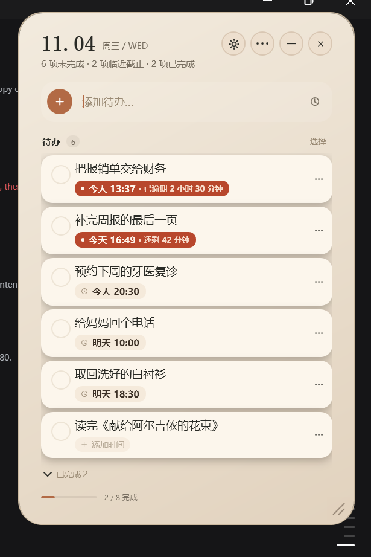
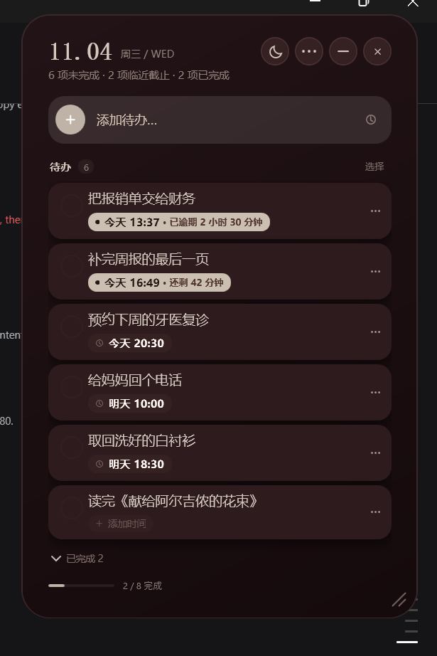
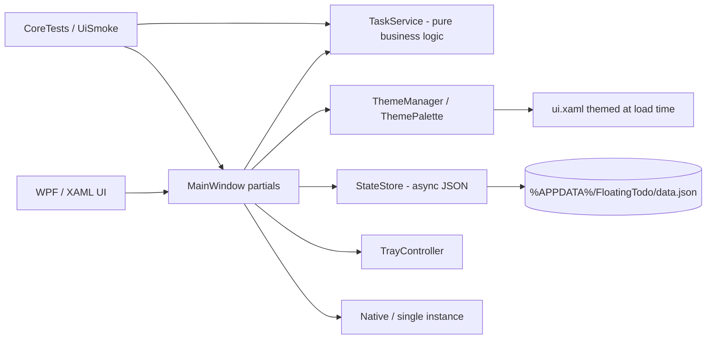

# FloatingTodo

English | [简体中文](README.md)

> A native Windows desktop todo widget built with C# + .NET Framework 4.8 + WPF. Single-file EXE, local-first.
>
> **Baseline: v1.3.1.** This is a stable, buildable, testable desktop-client baseline. The AI task assistant is planned, not implemented.





> Screenshots use demo data, not a real user's tasks.

## What this is

FloatingTodo is a lightweight todo widget that stays on the Windows desktop: open it, type a task, and keep the whole list inside one small card. Closing it saves the data; minimizing sends it to the system tray.

It is **not** a web app, a mini program, or a data-science/ML project. It solves one narrow problem: **capturing and finishing tasks on Windows with as little interruption as possible**.

The current UI is Simplified Chinese only. See [English users and i18n](#english-users-and-i18n) for the exact status.

## Features

- **Fast capture**: type a title, press Enter; set a due time from the same input row.
- **Today and upcoming**: sort by due time; tasks without a due date sink to the bottom; urgency is derived from a configurable lead time.
- **Quiet urgency**: normal and urgent tasks share the same surface color; only the time chip changes color.
- **Task details**: multi-line title, note, tags, and due time.
- **Tag filtering**: local tag names/colors and a filter row.
- **Batch actions**: complete/restore, reschedule, delete, and clear completed tasks.
- **Two themes**: light M (ivory/copper) and dark AA (dark wine/bone), switched instantly from the title bar and persisted.
- **Desktop behavior**: borderless rounded card, drag-resize from the bottom-right, remembered position/size, always-on-top, and desktop-position lock.
- **Tray and quit**: minimize to the notification area; the close button saves and quits; optional launch at login.
- **Accessibility hooks**: key controls expose AutomationProperties names and can be driven by UI Automation.

## Tech stack

| Layer | Technology |
|---|---|
| Language/runtime | C# 5 syntax, .NET Framework 4.8 |
| UI | WPF, XAML, code-behind partial classes |
| Theming | Semantic palette + runtime color adaptation |
| Persistence | DataContractJsonSerializer + asynchronous atomic JSON writes |
| Windows integration | Win32 single-instance messages, NotifyIcon, window styles/topmost |
| Tests | Console core tests + UIAutomation smoke tests + icon resource probe |
| Packaging | csc single-file EXE, PowerShell installer |

## Architecture



### Repository layout

```text
src/
  Models.cs                Models, tags, notes, window size, theme setting
  TaskService.cs           Sorting, due labels, batch operations, urgency (no UI)
  Storage.cs               Async atomic persistence, launch-at-login
  Theme.cs                 Theme modes, palettes, color mapping, XAML theming
  MainWindow.cs            Window shell, title bar, theme switch, lifecycle
  MainWindow.Tasks.cs      Task list, tag filter, batch mode, drag scrolling
  MainWindow.DuePicker.cs  Calendar / month-year / compact time picker
  MainWindow.Editor.cs     Detail editor, notes, tags, resize
  MainWindow.Menus.cs      Settings and task menus
  MainWindow.Modals.cs     Confirmation dialog
  Native.cs                Native calls, single-instance messaging
  TrayController.cs        Tray icon and menu
  ui.xaml                  XAML layout (embedded at compile time)
assets/
  app.ico                  Double-ring light icon (16–256 px)
  app.alert.ico            Tray alert icon (16–48 px)
  noise.png                UI texture
tests/
  CoreTests.cs             Core logic tests
  UiSmoke.ps1              UI Automation smoke test
  RunCoreTests.ps1         Core test entry point
  IconProbe.cs             Icon resource probe
installer/                 Install / uninstall scripts
docs/                      Theme screenshots and icon preview
```

### Theme design

`Theme.cs` provides:

- `ThemeMode`: Light / Dark.
- `ThemeRole`: semantic color slots for card, text, surfaces, accent, urgent time, shadow, etc.
- `ThemePalette`: immutable M/AA palettes.
- `ThemeManager`: current theme, legacy color adaptation, and XAML theming before parse.

New UI should consume `ThemeRole` rather than hard-coding hex values. `ui.xaml` keeps one layout and is transformed at load time, so there is no second copy of the interface.

## Build

Requirements:

- Windows 10/11
- .NET Framework 4.8
- Windows PowerShell 5.1

```powershell
powershell -NoProfile -ExecutionPolicy Bypass -File .\build.ps1
```

Output: `build\FloatingTodo.exe`.

Build the install package:

```powershell
powershell -NoProfile -ExecutionPolicy Bypass -File .\package.ps1
```

Output: `release\浮光待办-v1.3.1.zip` (not committed).

## Tests

Core logic:

```powershell
powershell -NoProfile -ExecutionPolicy Bypass -File .\tests\RunCoreTests.ps1
```

Current result: **34 / 34 passed**.

UI smoke test (requires an interactive desktop session):

```powershell
powershell -NoProfile -ExecutionPolicy Bypass -File .\tests\UiSmoke.ps1
```

Current result: **12 / 12 passed**, covering launch, add, complete, light/dark switching and persistence, minimize-to-tray, restore, direct quit, and restart persistence.

Icon probe:

```powershell
$csc = "C:\Windows\Microsoft.NET\Framework64\v4.0.30319\csc.exe"
& $csc /nologo /target:exe /out:tests\IconProbe.exe /r:System.Drawing.dll tests\IconProbe.cs
& tests\IconProbe.exe build\FloatingTodo.exe icon-probe
```

The icon set covers 16/20/24/32/40/48/64/128/256. 16/20 px use an optical simplification; the complete double-ring mark returns from 32 px.

## Data and privacy

- Data directory: `%APPDATA%\FloatingTodo`.
- Single JSON file: `data.json`; atomic writes keep `data.bak.json`.
- No server, account, telemetry, or network upload.
- Tests use an isolated directory via `FLOATING_TODO_DATA_DIR` and never touch real data.
- Installing/upgrading does not delete user data; back up `%APPDATA%\FloatingTodo` before replacing the executable.

## Engineering decisions

- **No Electron**: a native WPF app keeps the runtime and memory footprint small.
- **Single-file delivery**: XAML, texture, and icons are embedded into the EXE to simplify install/upgrade.
- **Business logic separated from UI**: `TaskService` has no window dependency and is directly testable.
- **Persistence never blocks interaction**: the UI thread serializes a snapshot; a background thread writes it; shutdown flushes synchronously.
- **Theme isolated**: color mapping lives in the Theme layer; rows, menus, calendar, and editor reuse semantic colors.
- **UI automation**: key controls expose AutomationProperties, enabling regression tests rather than manual-only checks.

## English users and i18n

**Status: English documentation only; the application UI is not localized yet.**

- The app UI is currently **Simplified Chinese only**. This README is the English documentation entry point; the app itself will still show Chinese labels.
- UI strings are currently spread across `ui.xaml` and C# code. There is no `.resx` resource layer and no language switcher.
- Date/time labels such as "today", "tomorrow", and the weekday line are generated in Chinese. An English UI needs culture-aware formatting, not just string replacement.
- Task titles and tags are Unicode and stored language-neutrally in JSON.
- English labels are usually longer than Chinese ones. The compact window (down to 330×460) has not been tested with English text; wrapping, truncation, and layout need a dedicated pass.
- The app relies on Windows fonts (Microsoft YaHei UI and SimSun for the date); an English build should verify font fallback.
- Planned i18n steps: extract strings → culture-aware date/time → English layout tests → font fallback → language setting with persistence.

English users can build and run the baseline today, but should expect a Chinese interface.

## Known limitations

- Windows only; requires .NET Framework 4.8.
- UI is Simplified Chinese only; English docs are available, English UI is not.
- Single instance and local storage; no cloud sync, collaboration, or mobile client.
- No AI features, backend, database, or account system yet.
- The tray menu still uses an older dark style and is not connected to the M/AA theme.
- Switching themes rebuilds the interface; an open editor/popup closes during the switch.

## Roadmap: AI Task Assistant (not implemented)

This repository is the baseline. The next step can add, without changing the core task model:

1. **Natural-language task capture**: parse "submit the report tomorrow at 3pm #work" into title, due time, and tags.
2. **Structured output with fallback**: JSON output from an LLM; on timeout/low confidence, fall back to rules or ask the user to confirm.
3. **Evaluation set**: 200–300 Chinese/English instructions; measure field accuracy, intent accuracy, P95 latency, and cost per request.
4. **Local service boundary**: client → local Python/FastAPI → model API; never ship API keys in the client.
5. **Privacy switch**: networking off by default; when enabled, show exactly which fields are sent.
6. **Product metrics**: suggestion acceptance rate, edit rate, time-to-create, fallback rate.

AI work will arrive as separate PRs; the baseline does not pretend it is already an AI product.

## Status

- Version: `1.3.1`
- Build: passing
- Core tests: 34/34
- UI smoke: 12/12
- Icon: double-ring light, multi-size ICO, no outer stroke
- Documentation: Simplified Chinese + English

---

Personal project for desktop-client / product-engineering practice and follow-up AI application experiments.
