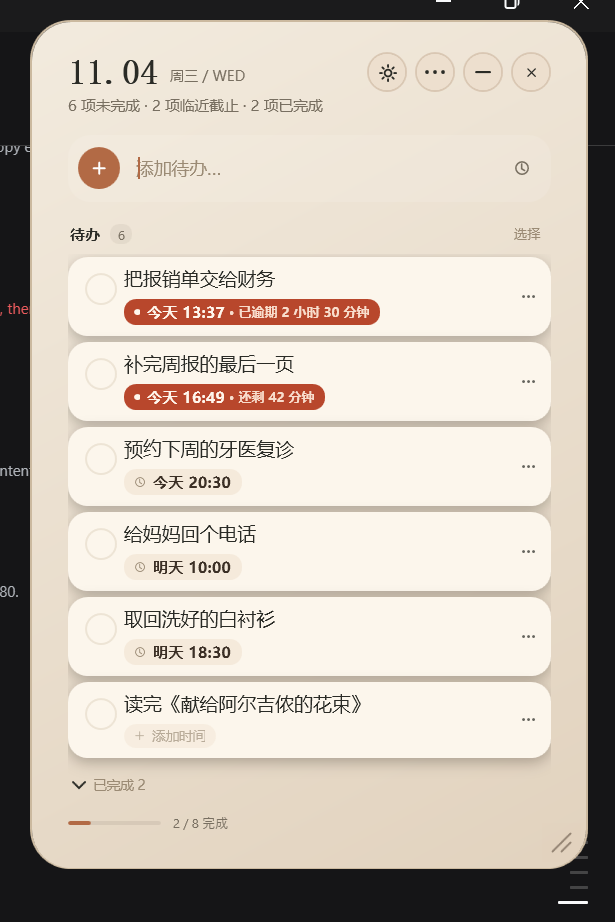
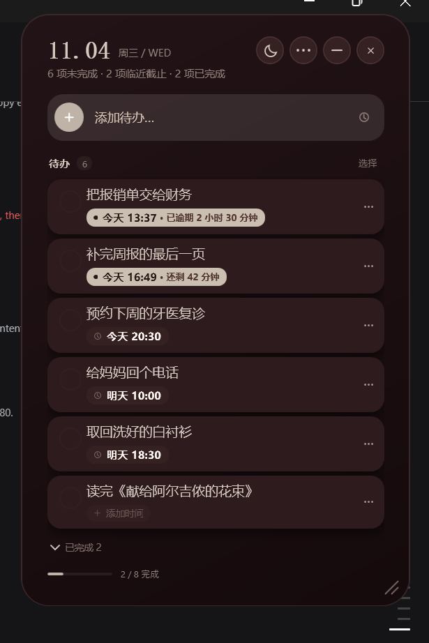
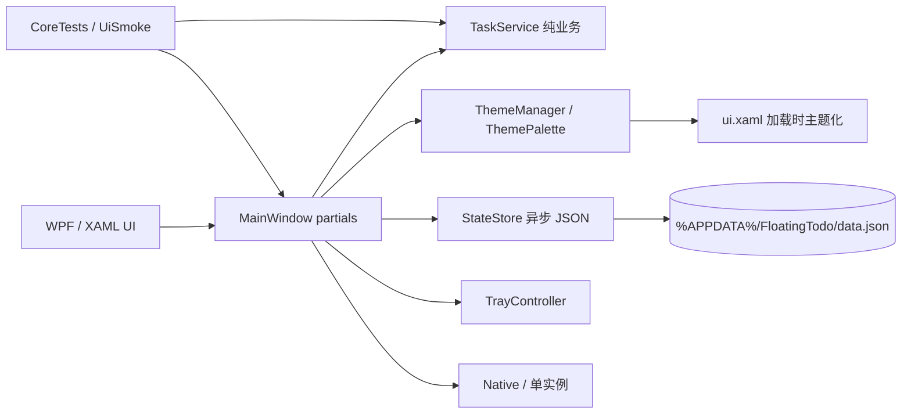

# 浮光待办 · FloatingTodo

> 原生 Windows 桌面待办小组件。C# + .NET Framework 4.8 + WPF，单文件 EXE，本地数据。
>
> **Baseline：v1.3.1**。这是一个稳定、可构建、可测试的桌面客户端基线；AI 任务助手尚未实现，规划见文末。





> 截图使用演示数据，不包含真实用户待办。

## 项目定位

浮光待办是一个常驻桌面的轻量待办工具：打开即记录，任务与截止时间都保持在一张小卡片里；关闭即保存，最小化收进系统托盘。

它不是 Web 应用，也不是数据科学/算法项目。它解决的问题是：**在 Windows 桌面上，以尽量低的打断成本记录和完成待办**。

## 功能

- **快速录入**：输入标题后回车即可新增；输入框旁可直接设置截止时间。
- **今日与临期**：按截止时间排序，无截止任务置底；到期前按提醒阈值标红。
- **紧急标记**：普通/紧急任务使用相同底色；仅时间条改变颜色，不靠整行铺色制造噪音。
- **任务详情**：多行标题、备注、标签、截止时间编辑。
- **标签筛选**：任务标签与筛选条；标签名称/颜色保存在本地。
- **批量操作**：批量完成/恢复、批量改截止、批量删除、清除已完成。
- **双主题**：浅色 M（象牙、铜色）与深色 AA（暗酒、骨白），标题栏太阳/月亮即时切换；选择持久化。
- **桌面形态**：无系统标题栏的圆角卡片、右下角拖拽缩放、窗口位置/尺寸记忆、固定最上层、锁定桌面位置。
- **托盘与退出**：最小化收进托盘；右上角关闭直接保存并退出；可选开机自动显示。
- **无障碍/可读性**：关键操作有 AutomationProperties 名称，UI 自动化可驱动。

## 技术栈

| 层 | 技术 |
|---|---|
| 语言/运行时 | C# 5 语法，.NET Framework 4.8 |
| UI | WPF、XAML、代码后置 partial 类 |
| 主题 | 语义色板 + 运行时颜色适配 |
| 持久化 | DataContractJsonSerializer + 异步原子 JSON 写入 |
| Windows 集成 | Win32 单实例消息、NotifyIcon、窗口样式/置顶 |
| 测试 | 控制台核心测试 + UIAutomation 冒烟 + 图标资源检查 |
| 打包 | csc 单文件 EXE、PowerShell 安装包 |

## 架构



### 模块划分

```text
src/
  Models.cs                数据模型、标签、备注、窗口尺寸、主题设置
  TaskService.cs           排序、时间文案、批量操作、紧急度（不依赖 UI）
  Storage.cs               异步原子持久化、开机启动
  Theme.cs                 主题模式、色板、颜色适配、XAML 主题化
  MainWindow.cs            窗口壳、标题栏、主题切换、生命周期
  MainWindow.Tasks.cs      任务列表、标签筛选、批量、拖动滚动
  MainWindow.DuePicker.cs  日历 / 年月 / 紧凑时间下拉
  MainWindow.Editor.cs     详情编辑、备注、标签、窗口缩放
  MainWindow.Menus.cs      设置菜单、任务菜单
  MainWindow.Modals.cs     确认弹窗
  Native.cs                单实例消息等原生调用
  TrayController.cs        托盘图标与菜单
  ui.xaml                  XAML 界面结构（编译时嵌入）
assets/
  app.ico                  双环浅色应用图标（16–256 px）
  app.alert.ico            托盘紧急状态图标（16–48 px）
  noise.png                界面纹理
tests/
  CoreTests.cs             核心逻辑测试
  UiSmoke.ps1              UI 自动化冒烟
  RunCoreTests.ps1         核心测试入口
installer/                 安装/卸载脚本
docs/                      主题截图与图标预览
```

### 主题设计

`Theme.cs` 提供：

- `ThemeMode`：Light / Dark。
- `ThemeRole`：卡片、文字、表面、强调、紧急时间、阴影等语义色槽。
- `ThemePalette`：不可变的 M/AA 两套色板。
- `ThemeManager`：当前主题、旧界面颜色适配、XAML 加载前主题化。

新增界面应优先消费 `ThemeRole`，不要继续写死十六进制。`ui.xaml` 保持一套结构，加载时统一转换，避免维护两份布局。

## 构建

环境：

- Windows 10/11
- .NET Framework 4.8
- Windows PowerShell 5.1

```powershell
powershell -NoProfile -ExecutionPolicy Bypass -File .\build.ps1
```

产物：`build\FloatingTodo.exe`。

打包安装目录：

```powershell
powershell -NoProfile -ExecutionPolicy Bypass -File .\package.ps1
```

产物：`release\浮光待办-v1.3.1.zip`（不提交到仓库）。

## 测试

核心逻辑：

```powershell
powershell -NoProfile -ExecutionPolicy Bypass -File .\tests\RunCoreTests.ps1
```

当前结果：**34 / 34 通过**。

UI 冒烟（需要桌面会话）：

```powershell
powershell -NoProfile -ExecutionPolicy Bypass -File .\tests\UiSmoke.ps1
```

当前结果：**12 / 12 通过**，覆盖启动、新增、完成、深浅主题切换与持久化、最小化驻留、恢复、直接退出、重启保留。

图标检查：

```powershell
$csc = "C:\Windows\Microsoft.NET\Framework64\v4.0.30319\csc.exe"
& $csc /nologo /target:exe /out:tests\IconProbe.exe /r:System.Drawing.dll tests\IconProbe.cs
& tests\IconProbe.exe build\FloatingTodo.exe icon-probe
```

图标尺寸覆盖 16/20/24/32/40/48/64/128/256；16/20 做小尺寸光学校正，32 起完整双环。

## 数据与隐私

- 数据目录：`%APPDATA%\FloatingTodo`。
- 单文件 JSON：`data.json`；原子写入并保留 `data.bak.json`。
- 无服务器、无账号、无遥测、无网络上传。
- 测试通过 `FLOATING_TODO_DATA_DIR` 使用独立目录，不触碰真实数据。
- 安装/升级不删除用户数据；替换程序前建议备份 `%APPDATA%\FloatingTodo`。

## 工程决策

- **不引入 Electron**：桌面小工具用原生 WPF，减少运行时和内存占用。
- **单文件交付**：把 XAML/纹理/图标嵌入 EXE，降低安装与升级成本。
- **业务与 UI 分离**：`TaskService` 不依赖窗口，核心测试可直接编译运行。
- **持久化不阻塞交互**：UI 线程序列化快照，后台线程写盘；退出前同步落盘。
- **主题独立**：颜色映射集中在 Theme 层，任务行/菜单/日历/编辑器复用语义色。
- **UI 自动化**：关键控件有 AutomationProperties，能用 UIAutomation 做回归，不只靠手点。

## 已知限制

- 仅 Windows；依赖 .NET Framework 4.8。
- 单实例、本地存储；没有云同步、协作、移动端。
- 目前没有 AI 功能；没有服务端、数据库、账号体系。
- 托盘菜单沿用较早的深色样式，尚未接入 M/AA 主题。
- 主题切换会重建界面；切换时正在打开的编辑/弹层会关闭。

## Roadmap：AI Task Assistant（未实现）

这个仓库作为 baseline，下一步可以在不改动核心任务模型的前提下增加：

1. **自然语言建任务**：把“明天下午三点交周报 #工作”解析为标题、截止时间、标签。
2. **结构化输出与兜底**：LLM 输出 JSON；超时/低置信度回退正则或让用户确认。
3. **评测集**：200–300 条中文指令，测字段准确率、意图准确率、P95 延迟、单次成本。
4. **本地服务边界**：客户端 → 本地 Python/FastAPI → 模型 API；密钥不下发客户端。
5. **隐私开关**：默认关闭联网；开启后明确告知发送字段。
6. **产品指标**：建议采纳率、编辑率、建任务耗时、失败回退率。

AI 功能会作为后续独立 PR 加入，不在 baseline 中伪装成已完成能力。

## 状态

- 版本：`1.3.1`
- 构建：通过
- 核心测试：34/34
- UI 冒烟：12/12
- 图标：双环浅色，多尺寸 ICO，无外描边

---

个人项目，用于桌面客户端 / 产品工程实践与后续 AI 应用实验。
